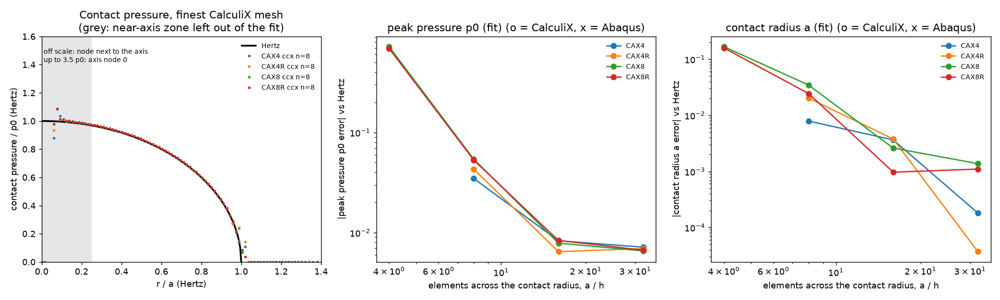

# fea-portfolio

Finite element analysis (FEA) verification studies: benchmarks with known
answers, each solved in **CalculiX** (open source) and cross-checked in
**Abaqus/Standard** from the same input deck, with mesh-convergence studies and
an explanation of every discrepancy.

The aim is to show how far a simulation result can be trusted, and why. Each
benchmark is compared with a closed-form or extrapolated reference, and the gaps
are traced to their cause: element formulation, mesh, boundary conditions or the
limits of the theory itself.



## Benchmarks

| # | Benchmark | What it checks | Status |
|---|-----------|----------------|--------|
| 0 | Single-element uniaxial tension | Material and boundary-condition setup; a user material subroutine (UMAT) | Both solvers match the closed form |
| 1 | End-loaded cantilever | Bending, shear locking, hourglassing, convergence order | CalculiX and Abaqus |
| 2 | Plate with a hole | Stress concentration factor, stress convergence | CalculiX and Abaqus |
| 3 | Hertz sphere-on-flat contact | Contact pressure and contact radius | CalculiX done; Abaqus runs in the repository, comparison pending |
| 4 | NAFEMS LE1 elliptic membrane | Standard benchmark from NAFEMS (National Agency for Finite Element Methods and Standards) | Planned |

Full models, results tables and derivations are in
[`verification/README.md`](verification/README.md).

## Selected findings

- **The same element name can hide different formulations.** Abaqus and CalculiX
  disagree by up to 87% on a coarse `C3D8` cantilever. An independent 8-node
  hexahedron solver written in NumPy reproduces both programs to every printed
  digit and shows the cause: Abaqus uses selectively reduced integration
  (the B-bar method), CalculiX plain full integration.
- **A clamped root, not the mesh, limits convergence.** Quadratic elements
  converge at order 1.6 instead of 4 on the cantilever. Removing the stress
  singularity at the clamped edge restores order 3.8 and brings the 3D model
  within 0.003% of Timoshenko beam theory.
- **Shear locking depends on element shape, not layer count.** Adding layers
  through the depth stalls at 72% of the answer; shortening the elements
  removes the locking.
- **Coarse reduced-integration results can be pure artefact.** With one `C3D8R`
  element through the depth, scaling the hourglass stiffness by 10 changes the
  deflection by exactly 10. Enhanced hourglass control brings it within 0.03%.
- **Plate with a hole: converged net stress concentration factor of 2.522,**
  0.55% above Peterson's handbook curve fit, from a mesh that reproduces the
  exact Kirsch solution to 0.013%.
- **Hertz contact: contact radius within 0.14% of theory** at 32 elements across
  the contact radius. The remaining +0.7% in peak pressure is shared by every
  element type and is traced to the small-contact assumption in Hertz theory,
  not to the mesh.
- **Solver pitfalls documented along the way:** wrong answers from multithreaded
  CalculiX 2.23 with no error message, unusable thin-section `CPS4R` elements,
  and incorrect contact pressure next to the axis in axisymmetric models.

## Quick start

Requirements: [uv](https://docs.astral.sh/uv/) and CalculiX (`ccx`). Abaqus is
needed only for the cross-checks; its results are already committed.

```bash
brew install costerwi/homebrew-calculix/calculix-ccx   # macOS
cd verification
uv run cantilever.py        # about 1 minute
uv run plate_hole.py        # about 10 seconds
uv run hertz_contact.py     # about 3 minutes
```

Each script writes its input decks, a `results.csv` and a convergence plot to
`verification/runs/<benchmark>/`. Results are also converted to VTK files for
viewing in ParaView.

## Repository layout

```
verification/
  README.md                  full write-up of every benchmark
  cantilever.py              benchmark 1 and its follow-up studies
  plate_hole.py              benchmark 2
  hertz_contact.py           benchmark 3
  *_check.py, *_sensitivity.py   investigations and modelling checks
  fea_common.py              deck writing, solver runs, result parsing
  frd2vtu.py                 CalculiX results to VTK
  runs/                      committed results, plots and Abaqus decks
```

## Tools

Python (NumPy, SciPy, pandas, Matplotlib), Gmsh for meshing, CalculiX 2.23,
Abaqus/Standard Learning Edition 2026, ParaView.

## License

[GPL-3.0](LICENSE) (GNU General Public License, version 3).
