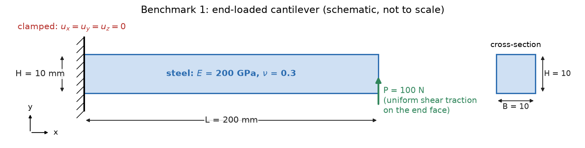
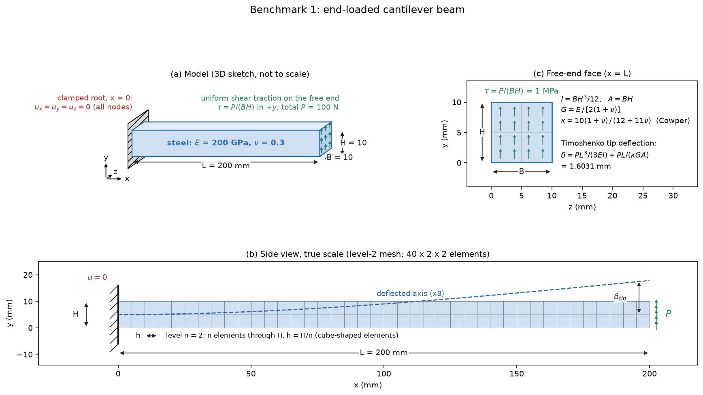
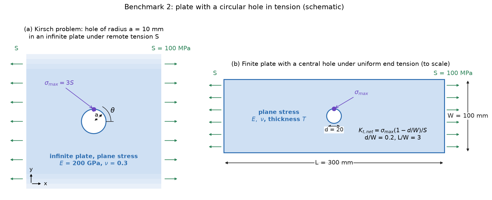
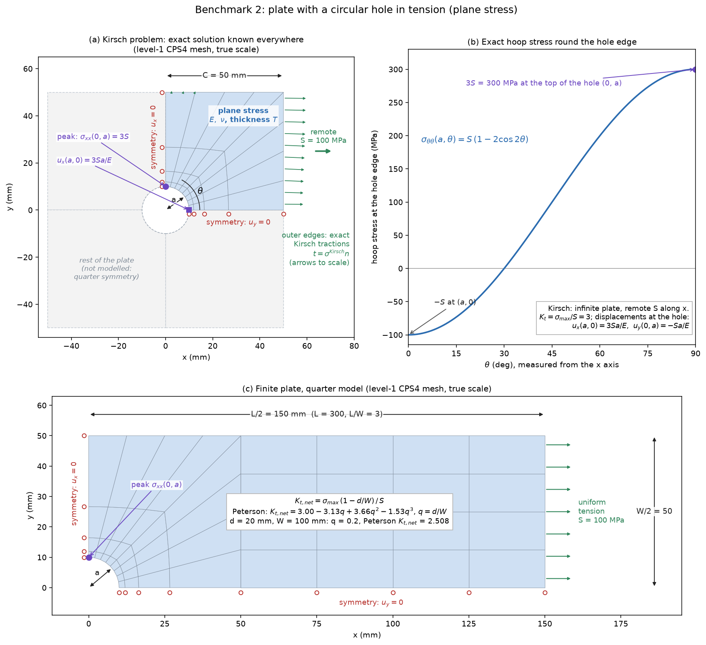
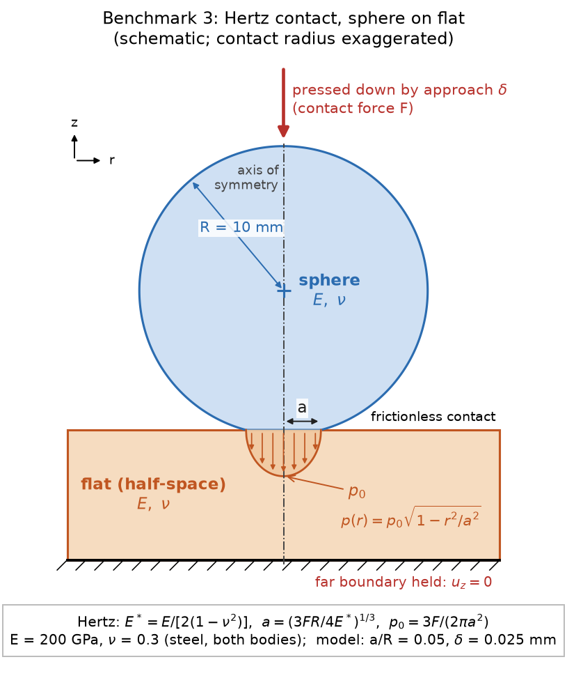
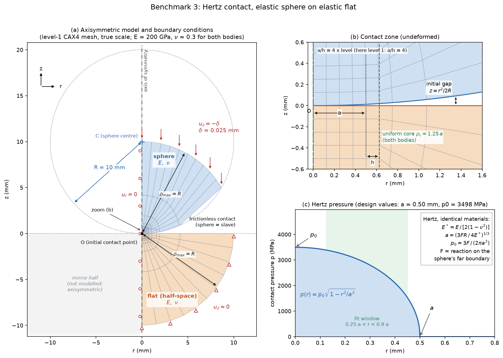
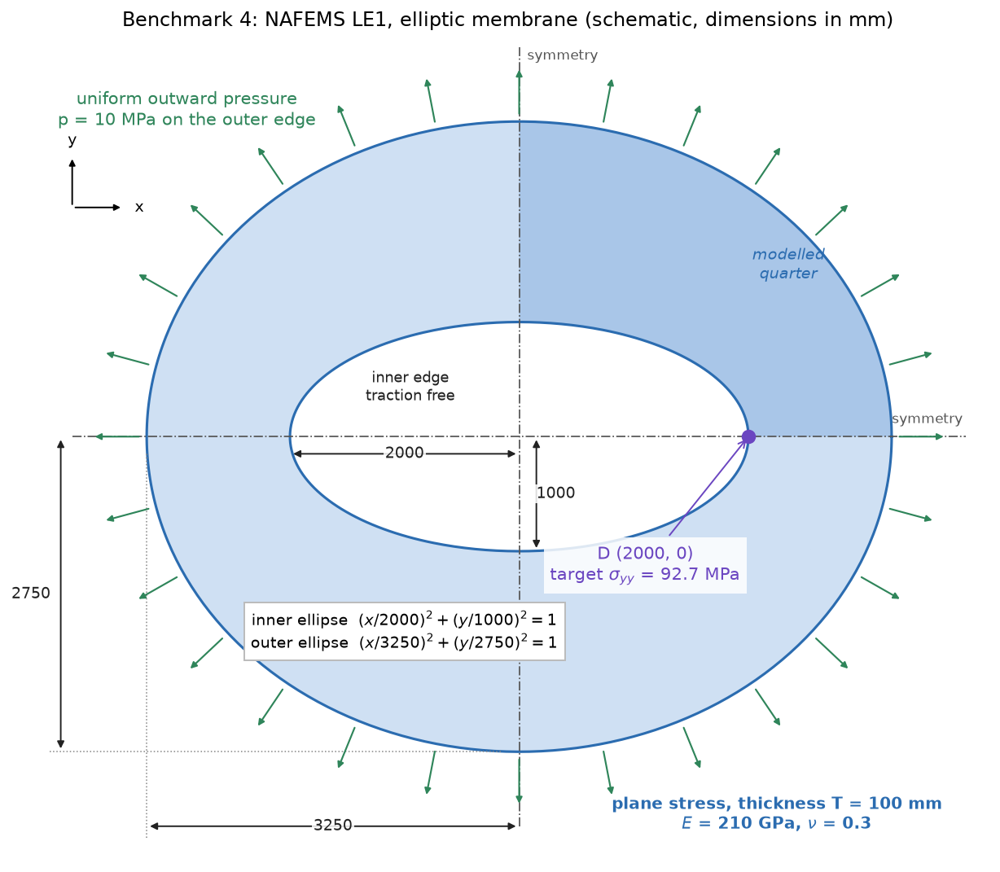
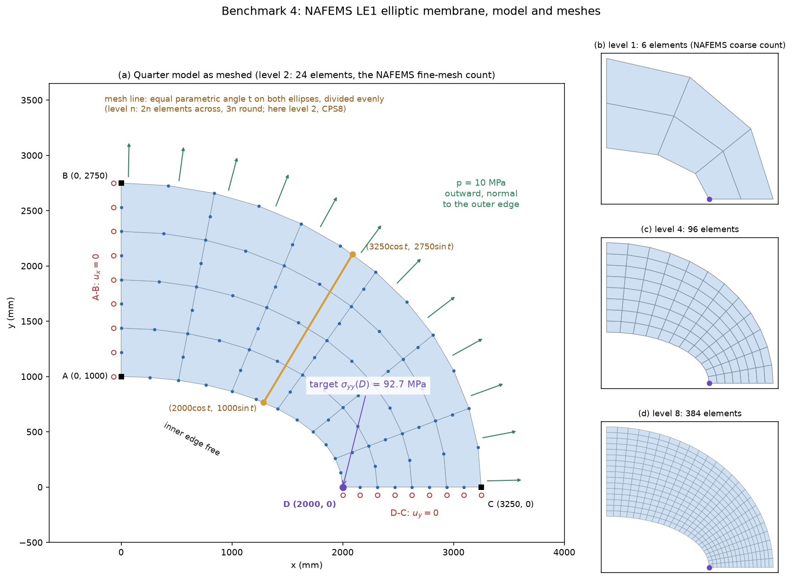
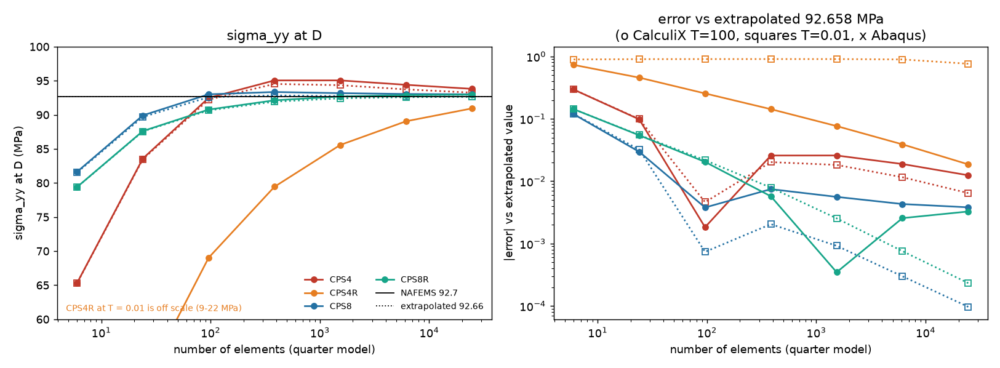

# FEA verification suite

Benchmarks with known answers, each run in **CalculiX** (ccx, open source) and
**Abaqus/Standard** from the same Abaqus-format input deck, with mesh-convergence
studies. Units: mm, N, MPa.

| # | Benchmark | Checks | Status |
|---|-----------|--------|--------|
| 0 | Single-element uniaxial tension (`tension.inp`) | Material and boundary-condition setup; ccx vs Abaqus | Done: both match closed form |
| 1 | End-loaded cantilever (`cantilever.py`) | Bending, shear locking, hourglassing, convergence rate | Done: CalculiX and Abaqus |
| 2 | Plate with a hole (`plate_hole.py`) | Stress concentration factor Kt, stress convergence | Done |
| 3 | Hertz sphere-on-flat contact (`hertz_contact.py`) | Contact pressure and radius | Done: CalculiX and Abaqus |
| 4 | NAFEMS LE1 elliptic membrane (`nafems_le1.py`) | Standard benchmark from NAFEMS (National Agency for Finite Element Methods and Standards): stress at a curved free edge on a mapped mesh | CalculiX done; Abaqus pending |

## Setup

Python dependencies are managed with [uv](https://docs.astral.sh/uv/) from
`pyproject.toml`; `uv run` creates `.venv/` and installs them on first use.

```bash
brew install costerwi/homebrew-calculix/calculix-ccx
uv sync          # optional: uv run does this automatically
```

Homebrew installs CalculiX as a versioned binary (e.g. `ccx_2.23`) with no plain
`ccx`. The scripts find the newest `ccx_<version>` on `PATH` automatically; a
shell alias is not enough because Python cannot see aliases. Pass `--ccx <path>`
to use a specific binary.

The scripts run CalculiX on **one thread**. With ccx 2.23 the multithreaded
SPOOLES solver intermittently returned wrong answers with no error (the same deck
gave 0.06 mm on one 8-thread run and 1.403 mm on others), and these models are
too small to benefit from threads.

**Viewing results in ParaView.** Every CalculiX run made through
`fea_common.run_ccx` also converts its `.frd` results to VTK files next to the
deck (`frd2vtu.py`, numpy only):
- `<job>.vtu`: the mesh with the results of the last increment (DISP, STRESS,
  von_Mises, and CONTACT for contact runs).
- `<job>.pvd` and `<job>_inc<k>.vtu`: a time series of every increment, written
  only when there is more than one (the contact runs), to step through the
  loading.

Open the `.vtu` (or `.pvd`) in ParaView, click Apply and colour by a result. For
the deformed shape add Filters > Warp By Vector with DISP and a scale factor.
CalculiX decks written by the scripts ask for U and S in the `.frd`; the Abaqus
decks are unchanged. The `.vtu` and `.frd` files are not committed (see
`.gitignore`); rerun a script, or run `uv run frd2vtu.py <file>.frd` on an
existing result, to regenerate them. Pass `vtu=False` to `run_ccx` to skip the
conversion.

## Contents

- [Benchmark 1: cantilever beam](#benchmark-1-cantilever-beam)
  - [Model and references](#model-and-references)
  - [Running the Abaqus cross-check](#running-the-abaqus-cross-check)
  - [Results](#results)
  - [Investigations](#investigations)
    - [Why Abaqus and CalculiX disagree on C3D8 (`c3d8_formulation_check.py`)](#why-abaqus-and-calculix-disagree-on-c3d8-c3d8_formulation_checkpy)
    - [Why the convergence order is 1.6 (`root_singularity_check.py`)](#why-the-convergence-order-is-16-root_singularity_checkpy)
    - [C3D8 locking: element shape vs layers (`element_aspect_check.py`)](#c3d8-locking-element-shape-vs-layers-element_aspect_checkpy)
    - [C3D8R hourglass control in Abaqus (`c3d8r_hourglass_check.py`)](#c3d8r-hourglass-control-in-abaqus-c3d8r_hourglass_checkpy)
- [Benchmark 2: plate with a hole](#benchmark-2-plate-with-a-hole)
  - [Model and references](#model-and-references-1)
  - [Running the Abaqus cross-check](#running-the-abaqus-cross-check-1)
  - [Results: CalculiX 2.23](#results-calculix-223)
  - [Results: Abaqus cross-check (Learning Edition 2026)](#results-abaqus-cross-check-learning-edition-2026)
  - [Modelling checks (`plate_hole_sensitivity.py`)](#modelling-checks-plate_hole_sensitivitypy)
    - [Section thickness in CalculiX](#section-thickness-in-calculix)
    - [Plate length](#plate-length)
- [Benchmark 3: Hertz contact, sphere on flat](#benchmark-3-hertz-contact-sphere-on-flat)
  - [Model and references](#model-and-references-2)
  - [Running the Abaqus cross-check](#running-the-abaqus-cross-check-2)
  - [Results: CalculiX 2.23](#results-calculix-223-1)
  - [Results: Abaqus cross-check (Learning Edition 2026)](#results-abaqus-cross-check-learning-edition-2026-1)
  - [Modelling checks (`hertz_sensitivity.py`)](#modelling-checks-hertz_sensitivitypy)
    - [Contact size a/R](#contact-size-ar)
    - [Penalty stiffness](#penalty-stiffness)
    - [Body size](#body-size)
- [Benchmark 4: NAFEMS LE1 elliptic membrane](#benchmark-4-nafems-le1-elliptic-membrane)
  - [Model and references](#model-and-references-3)
  - [What to watch for](#what-to-watch-for)
  - [Running the Abaqus cross-check](#running-the-abaqus-cross-check-3)
  - [Results: CalculiX 2.23](#results-calculix-223-2)

## Benchmark 1: cantilever beam

### Model and references

Steel beam, 200 x 10 x 10 mm, clamped at x = 0, uniform shear traction totalling
P = 100 N on the free end. Five element types (C3D8, C3D8R, C3D8I, C3D20, C3D20R)
at four mesh levels (1, 2, 4, 8 elements through the depth; cube-shaped elements).





The schematic shows the problem; the second figure shows the model as meshed
(actual level-2 mesh). Both are drawn by `uv run cantilever_geometry.py` (no
solver run needed).

```bash
uv run cantilever.py                    # full sweep, ~1 minute on a laptop
uv run cantilever.py --levels 1 2 4     # quicker
```

Outputs go to `runs/cantilever/`: `results.csv`, `cantilever_convergence.png`,
and the decks.

**Tip deflection measure.** The script reports the load-weighted tip deflection,
sum(f_i * v_i) / P, which is the displacement conjugate to the applied load. It
is the quantity beam theory predicts, and it is not biased by local distortion of
the loaded face.

**References.**
- Timoshenko beam theory (bending + shear, Cowper shear coefficient): 1.6031 mm.
- Richardson extrapolation of the three finest C3D20 meshes (n = 2, 4, 8):
  **1.5976 mm**, the converged answer of the 3D model. Three meshes give three
  equations for the unknowns in d(h) = d_exact + C h^p, so the script solves for
  d_exact and the observed convergence order p (1.56 here). This separates mesh
  error from modelling error: the converged 3D value sits 0.34% below Timoshenko
  because the fully clamped 3D root also blocks Poisson contraction, which beam
  theory ignores. The observed order is well below the h^4 expected for quadratic
  elements; see [Why the convergence order is 1.6](#why-the-convergence-order-is-16-root_singularity_checkpy).

### Running the Abaqus cross-check

Learning Edition, 1,000-node cap.

Every case under 1,000 nodes is also written to `runs/cantilever/abaqus/` with
`run_all.bat`.

1. Copy `runs/cantilever/abaqus/` to the Windows VM (Git or Remote Desktop).
2. In an Abaqus Command window in that folder, run `run_all.bat`.
3. Copy the `.dat` files back into `runs/cantilever/abaqus/`.
4. Run `uv run cantilever.py --collect-abaqus`. Abaqus results appear as x markers
   on the plot and as `solver=abaqus` rows in `results.csv`. Without the flag the
   script ignores the Abaqus `.dat` files.

### Results

Tip deflection as a fraction of Timoshenko (1.6031 mm). Abaqus runs only the
cases under its 1,000-node cap.

| Element | Solver | n=1 | n=2 | n=4 | n=8 |
|---|---|---|---|---|---|
| C3D8 | ccx | 0.646 | 0.875 | 0.962 | 0.988 |
| C3D8 | Abaqus | 1.207 | 0.980 | | |
| C3D8R | ccx | 2.77 | 1.175 | 1.035 | 1.006 |
| C3D8R | Abaqus (default hourglass) | 91.7 | 1.325 | | |
| C3D8I | ccx | 0.9936 | 0.9937 | 0.9953 | 0.9961 |
| C3D8I | Abaqus | 0.9948 | 0.9939 | | |
| C3D20 | ccx | 0.9901 | 0.9948 | 0.9960 | 0.9964 |
| C3D20 | Abaqus | 0.9901 | | | |
| C3D20R | ccx | 0.9912 | 0.9953 | 0.9961 | 0.9965 |
| C3D20R | Abaqus | 0.9912 | | | |

**Element behaviour**
- **C3D8 in CalculiX** (full 2x2x2 integration) shear-locks in bending: 65% of
  the answer with one element through the depth, still 1% low at eight
  (13,000 nodes), converging at about order 2. Refinement mitigates locking
  only if the elements stay short relative to their depth; adding layers
  through the depth alone barely helps (see [C3D8 locking: element shape vs
  layers](#c3d8-locking-element-shape-vs-layers-element_aspect_checkpy)). It does not cure volumetric locking in nearly incompressible
  materials either.
- **C3D8R** with one element through the depth hourglasses: bending is then
  exactly an hourglass mode, so the only bending stiffness is the solver's
  artificial hourglass control. CalculiX gives 2.8x, Abaqus 92x. Two elements
  through the depth are the minimum for reduced-integration linear bricks in
  bending, and even then they are 17-32% too flexible.
- **C3D8I** (incompatible modes) is within 0.7% on the coarsest mesh in both
  solvers: the cheapest accurate element for bending.
- **C3D20 and C3D20R** are within 1% everywhere and converge fastest.

**CalculiX vs Abaqus**
- **C3D20 and C3D20R agree to 1e-7.** The two solvers read the same deck with the
  same loads and supports, which validates the deck writer, the load
  distribution and the result parsing.
- **C3D8I agrees to 1e-3** (n=1) and 1e-4 (n=2). The small gap most likely comes from
  differences in how the two programs implement incompatible modes.
- **C3D8R disagrees by design**: hourglass control is solver-specific, so its
  coarse-mesh results are not comparable across programs.
- **C3D8 is not the same element in the two programs.** Abaqus's C3D8 at n=1 is
  21% *too flexible*, where a full-integration element should lock and be too
  stiff. The run was clean (no warnings, linear, residual 6e-10), and the
  deformed shape matched CalculiX's up to a scale factor.

### Investigations

Follow-up studies that explain the results above. Each has its own script.

#### Why Abaqus and CalculiX disagree on C3D8 (`c3d8_formulation_check.py`)

Abaqus/Standard's C3D8 uses *selectively reduced integration*: the volumetric
strain at each integration point is replaced by the element average (the
mean-dilatation, or B-bar, method), which avoids volumetric locking in nearly
incompressible materials. CalculiX's C3D8 is plain full integration.

`c3d8_formulation_check.py` implements an independent 8-node hex solver in numpy
in both variants and runs it on the same mesh and loads:

```bash
uv run c3d8_formulation_check.py
```

| Case | numpy full | ccx C3D8 | numpy B-bar | Abaqus C3D8 |
|---|---|---|---|---|
| n=1, nu=0.3 | 1.036184 | 1.036184 | 1.934318 | 1.934318 |
| n=2, nu=0.3 | 1.403038 | 1.403038 | 1.571293 | 1.571293 |
| n=1, nu=0 | 1.068000 | 1.068000 | 1.487937 | 1.487937 |

Each solver is reproduced to every printed digit, so the difference is entirely
the element formulation.

**Why B-bar makes a coarse bending mesh too flexible.** In bending, the axial
strain changes sign through the depth, so its element average is close to zero.
Replacing the volumetric part of the strain with that average removes part of
the real bending strain, and the element loses bending stiffness. With one
element through the depth this loss outweighs shear locking, which pushes the
other way. Both effects shrink with refinement (Abaqus 0.98, CalculiX 0.875 at
n=2).

**The nu = 0 case** was a check on that explanation. Setting nu = 0 removes the
Lamé lambda term, but B-bar still modifies the strain itself, so Abaqus stays
too flexible and even shows sideways displacement (U3 = 1.4e-5 mm) where plain
full integration gives zero. Its Abaqus deck and `run_diag.bat` are in
`runs/cantilever/diag/abaqus/`.

**Takeaway.** The same element name can hide different formulations. Compare
solvers on elements with a common definition (C3D20, C3D20R, approximately
C3D8I), and check the theory manual before treating a "C3D8" result from one
code as a reference for another.

#### Why the convergence order is 1.6 (`root_singularity_check.py`)

For quadratic elements on a smooth problem, the load-weighted deflection (the
compliance, an energy quantity, which converges at twice the energy-norm rate)
should converge as h^4. The benchmark gives 1.96 and then 1.56. Two features of
the benchmark make the exact solution singular, and this script removes them one
at a time (C3D20, CalculiX, n = 1, 2, 4, 8):

```bash
uv run root_singularity_check.py      # ~1 minute; writes runs/cantilever/root_check_results.csv
```

| Variant | Root | End loads | Order (n=1,2,4) | Order (n=2,4,8) |
|---|---|---|---|---|
| A: benchmark | fully clamped | uniform tip shear | 1.96 | 1.56 |
| B | fully clamped | parabolic tip shear (zero at top and bottom faces) | 1.96 | 1.56 |
| C: smooth | fixed in x only, free to contract | parabolic shear at both ends, balanced | 3.88 | 3.78 |

- **The clamped root limits the convergence order.** Blocking the Poisson
  contraction at the root makes stresses singular along the root edges, and
  polynomial elements of any order converge slowly near a singularity under
  uniform refinement. Remove it (C) and the order rises to about 4, as theory
  predicts.
- **The uniform tip traction makes no measurable difference.** Its jump against
  the traction-free top and bottom faces is also a singularity, but making the
  traction parabolic (B) leaves the orders unchanged.
- **Without the clamp, the 3D model agrees with beam theory.** Variant C
  converges to 1.603099 mm, within 0.003% of Timoshenko (1.603060 mm). The 0.34%
  gap in the benchmark is therefore entirely the clamped root, not mesh error or
  the theory.
- **Practical consequence.** Because the order drifts, Richardson extrapolation
  of the benchmark is only approximate. The spread between the extrapolations
  from meshes (1, 2, 4) and (2, 4, 8), 1.59732 vs 1.59764 mm (0.02%), is a fair
  error bar.

In variant C the loads balance exactly, so the three point supports that stop
rigid-body motion carry no load and add no singularity of their own.

#### C3D8 locking: element shape vs layers (`element_aspect_check.py`)

In the main sweep, refining C3D8 adds layers through the depth *and* shortens
the elements along the beam, so the elements stay cubes. This study separates
the two (CalculiX, C3D8, tip deflection relative to the converged value):

```bash
uv run element_aspect_check.py   # a few seconds; writes runs/cantilever/aspect_check_results.csv
```

| Series | Mesh at level n | Element length / depth | n=1 | n=2 | n=4 | n=8 | n=16 |
|---|---|---|---|---|---|---|---|
| S1 cubes (main sweep) | 20n x n x n | 1 | 0.649 | 0.878 | 0.966 | 0.991 | |
| S2 layers only | 20 x n x n | n | 0.649 | 0.699 | 0.713 | 0.716 | |
| S3 length only | 20n x 1 x 1 | 1/n | 0.649 | 0.799 | 0.849 | 0.862 | 0.866 |
| S4 length only, nu = 0 | 20n x 1 x 1 | 1/n | 0.667 | 0.889 | 0.970 | 0.992 | 0.998 |

S4 is compared with Timoshenko at nu = 0 (1.6024 mm). With no Poisson effect
the clamped root blocks nothing, so the 3D answer and beam theory coincide.

- **Adding layers alone does not cure shear locking.** With the element length
  fixed at 10 mm, eight layers (1,700 nodes) improve the answer only from 0.65
  to 0.72, and it stalls there. Each layer is thinner, so the elements become
  more elongated (length/depth = n), and parasitic shear in a full-integration
  brick grows with that ratio.
- **Shear locking is controlled by element length relative to depth.** Making
  the elements shorter (S3, S4) removes it, even with a single element through
  the depth. At nu = 0, one layer of short elements converges to 0.998 of the
  exact answer.
- **With one layer, Poisson locking remains.** At nu = 0.3, S3 stalls at 0.87. A
  single element through the depth gives a transverse strain that is constant
  through the depth, but in bending the Poisson strain must vary linearly from
  tension to compression side. The element cannot deform that way, so it is
  too stiff. S4 confirms it: with nu = 0 the stall disappears.
- **So the cube sweep converges because it fixes both at once.** Short elements
  remove shear locking, and several layers let the Poisson strain vary through
  the depth. Either one alone stalls.
- **Practical rule.** For full-integration C3D8 in bending, keep element length
  close to element depth, and use several elements through the depth. Better
  still, use C3D8I or C3D20, which reach under 1% error with one element through
  the depth.

#### C3D8R hourglass control in Abaqus (`c3d8r_hourglass_check.py`)

With one element through the depth, bending of a reduced-integration brick is
exactly an hourglass mode, so its only bending stiffness is the artificial
hourglass stiffness. The script writes the C3D8R decks for n = 1 and 2 (the
meshes under the Learning Edition cap) in four hourglass-control variants.
CalculiX 2.23 ignores `*SECTION CONTROLS` (it warns and gives the same answer),
so the study is Abaqus-only.

```bash
uv run c3d8r_hourglass_check.py   # writes decks + run_hg.bat; tabulates any .dat present
```

| Variant | n=1 (mm) | x converged | n=2 (mm) | x converged |
|---|---|---|---|---|
| Default (no `*SECTION CONTROLS`) | 146.99 | 92.0 | 2.1238 | 1.329 |
| `HOURGLASS=STIFFNESS`, scale 1 | 146.99 | 92.0 | 2.1238 | 1.329 |
| `HOURGLASS=STIFFNESS`, scale 10 | 14.701 | 9.20 | 2.0487 | 1.282 |
| `HOURGLASS=ENHANCED` | 1.5972 | 0.9997 | 1.5934 | 0.9974 |

"x converged" is relative to the C3D20 Richardson value, 1.5976 mm. Results are
in `runs/cantilever/hourglass_results.csv`.

- **The Abaqus/Standard default for this model is the stiffness method.** The
  default and `STIFFNESS` scale 1 are identical to every digit.
- **At n=1 the deflection is set entirely by an artificial parameter.**
  Scaling the hourglass stiffness by 10 cuts the deflection by exactly 10
  (146.99 to 14.70 mm). The result tells you about the hourglass setting, not
  about the beam.
- **At n=2 real bending stiffness takes over.** The 10x scale changes the result
  by only 3.5%, but the element is still 28-33% too flexible.
- **Enhanced hourglass control fixes coarse-mesh bending.** It is within 0.03% of
  the converged value with one element through the depth. That makes it as
  accurate as C3D8I here, because enhanced hourglass control is based on an
  assumed-strain formulation that captures linear bending.
- **Practical rule.** With C3D8R in bending, use enhanced hourglass control or at
  least four elements through the depth, and check the artificial strain energy
  (ALLAE) against the internal energy (ALLIE) in the `.odb`.

Abaqus prints one warning per deck with `*SECTION CONTROLS`: a generic notice
listing the element types the setting applies to. C3D8R is on the list, and the
message says it can then be ignored.

## Benchmark 2: plate with a hole

### Model and references

Plane stress, quarter model with symmetry, remote tension S = 100 MPa along x.
Hole radius a = 10 mm (d = 20), half-width 50 mm (W = 100, d/W = 0.2). The mesh
is a structured O-grid round the hole, graded towards it; each level halves
every element size. Element types: CPS4, CPS4R, CPS8, CPS8R in both solvers,
and CPS4I in Abaqus only (CalculiX 2.23 rejects it). Levels 1, 2, 4, 8.





The schematic shows the problem; the second figure shows the quarter models as
meshed (actual level-1 meshes). Both are drawn by `uv run plate_hole_geometry.py`
(no solver run needed). The Kirsch tractions in panel (a) of the second figure
are drawn to scale; on the top edge they are nearly zero.

```bash
uv run plate_hole.py                     # CalculiX sweep + plot, ~10 s
uv run plate_hole.py --collect-abaqus    # after running the Abaqus decks
uv run plate_hole.py --levels 1 2 4      # quicker
```

Outputs go to `runs/plate_hole/`: `results.csv`, `plate_hole_convergence.png`,
and the decks. The peak stress is the averaged nodal sigma_xx at the top of
the hole (0, a), as a postprocessor would report it.

**Two problems.**
- **Kirsch (exact).** A 100 x 100 mm square round the hole, loaded on its outer
  edges with the exact infinite-plate (Kirsch) stresses as consistent nodal
  forces. The FE model then has a known exact answer everywhere: peak stress
  3S = 300 MPa, and hoop stress S(1 - 2 cos 2 theta) round the hole edge. This
  is a true convergence test with no reference uncertainty.
- **Finite plate (practical).** A 100 x 300 mm plate with uniform tension on
  the ends, compared with Peterson's handbook curve fit, Kt_net = 3.00 - 3.13q
  + 3.66q^2 - 1.53q^3 with q = d/W (2.508 at q = 0.2), and with a
  Richardson-extrapolated FE value from the three finest CPS8 meshes.

**Section thickness 0.01 mm: why so thin.** CalculiX does not solve 2D elements
directly. It expands each plane-stress element into a 3D brick of the section
thickness, so it really solves a thin 3D plate. Near a hole a real plate is not
in exact plane stress: sigma_zz is non-zero inside (2.2 MPa at the hole with a
1 mm section) and the mid-plane peak rises with thickness relative to the hole
radius. A 0.01 mm section recovers plane stress; Abaqus solves true plane
stress, where the thickness only scales the loads, so the same section is used
for both. See [Modelling checks](#modelling-checks-plate_hole_sensitivitypy).

### Running the Abaqus cross-check

Learning Edition, 1,000-node cap.

Every case under 1,000 nodes is written to `runs/plate_hole/abaqus/` with
`run_all.bat` (26 decks, including CPS4I).

1. Copy `runs/plate_hole/abaqus/` to the Windows VM.
2. Run `run_all.bat` in an Abaqus Command window in that folder.
3. Copy the `.dat` files back into `runs/plate_hole/abaqus/`.
4. Run `uv run plate_hole.py --collect-abaqus`. Abaqus results appear as crosses
   on `plate_hole_convergence.png` and as `solver=abaqus` rows in `results.csv`.

### Results: CalculiX 2.23

**Kirsch problem**: peak stress error vs the exact 300 MPa.

| Element | n=1 | n=2 | n=4 | n=8 |
|---|---|---|---|---|
| CPS4 | -1.7% | +0.96% | +0.86% | +0.51% |
| CPS4R | -65% | -61% | -44% | -20% |
| CPS8 | -0.65% | -0.21% | -0.056% | -0.013% |
| CPS8R | +1.7% | +0.48% | +0.12% | +0.028% |

- **CPS8 converges cleanly to the exact answer**: the peak error falls about 4x
  per halving of the element size (order about 2), down to 0.013% at n=8, and
  the RMS hoop-stress error round the hole falls from 1.6 to 0.02 MPa. This
  verifies the mesh, the edge loads and the stress extraction.
- **CPS8R converges from above** at the same rate, slightly less accurate than
  CPS8.
- **CPS4 overshoots by about 0.5-1% and converges slowly.** Nodal stresses of
  linear elements are extrapolated from a stress that is constant or linear
  within each element, and the straight-sided elements only approximate the
  curved hole.
- **CPS4R in CalculiX is unusable with a thin section** (20% low at n=8). This
  is a CalculiX artefact, not a property of CPS4R: see the thickness check
  below, and the Abaqus CPS4R results, which behave normally.

**Finite plate**: Kt_net = sigma_peak (1 - d/W) / S.

| Element | n=1 | n=2 | n=4 | n=8 |
|---|---|---|---|---|
| CPS4 | 2.457 | 2.538 | 2.541 | 2.534 |
| CPS4R | 0.823 | 0.932 | 1.382 | 2.004 |
| CPS8 | 2.502 | 2.516 | 2.521 | 2.522 |
| CPS8R | 2.565 | 2.534 | 2.525 | 2.523 |

- **Converged FE value: Kt_net = 2.522** (Kt_gross = 3.153), from Richardson
  extrapolation of the three finest CPS8 meshes (observed order 1.96). CPS8 and
  CPS8R bracket it from below and above.
- **0.55% above Peterson's curve fit (2.508).** The same mesh and method
  reproduce the exact Kirsch solution to 0.013%, and the plate is long enough
  (below), so the gap most likely reflects how closely the handbook curve fit
  matches the exact solution rather than an FE error.

### Results: Abaqus cross-check (Learning Edition 2026)

Every case under the 1,000-node cap was run in Abaqus: levels 1, 2 and 4 for
the linear elements, and 1 and 2 for the quadratic ones (26 decks). All ran
without errors. The only warning is a generic note about section thickness in
contact, which does not apply here. Abaqus prints the averaged nodal stresses
(`*EL PRINT, POSITION=AVERAGED AT NODES`) to 4 significant figures, so its
peak stresses are resolved to 0.1 MPa (0.03%).

**Kirsch problem**: peak stress error vs the exact 300 MPa, Abaqus (CalculiX in
brackets).

| Element | n=1 | n=2 | n=4 |
|---|---|---|---|
| CPS4 | -2.2% (-1.7%) | +0.43% (+0.96%) | +0.57% (+0.86%) |
| CPS4R | -19% (-65%) | -8.7% (-61%) | -4.0% (-44%) |
| CPS4I | -4.2% (n/a) | -0.63% (n/a) | +0.067% (n/a) |
| CPS8 | -0.53% (-0.65%) | -0.20% (-0.21%) | |
| CPS8R | +1.7% (+1.7%) | +0.47% (+0.48%) | |

RMS hoop-stress error round the hole (MPa), Abaqus (CalculiX in brackets):

| Element | n=1 | n=2 | n=4 |
|---|---|---|---|
| CPS4 | 8.5 (9.2) | 1.36 (1.94) | 0.98 (1.49) |
| CPS4R | 38 (119) | 17.6 (108) | 8.3 (78) |
| CPS4I | 10.6 | 2.12 | 0.47 |
| CPS8 | 1.39 (1.65) | 0.39 (0.42) | |
| CPS8R | 2.43 (2.43) | 0.62 (0.62) | |

**Finite plate**: Kt_net, Abaqus (CalculiX in brackets). Converged FE value
2.522; Peterson 2.508.

| Element | n=1 | n=2 | n=4 |
|---|---|---|---|
| CPS4 | 2.446 (2.457) | 2.526 (2.538) | 2.534 (2.541) |
| CPS4R | 2.040 (0.823) | 2.299 (0.932) | 2.418 (1.382) |
| CPS4I | 2.410 (n/a) | 2.504 (n/a) | 2.523 (n/a) |
| CPS8 | 2.506 (2.502) | 2.517 (2.516) | |
| CPS8R | 2.566 (2.565) | 2.534 (2.534) | |

- **The quadratic elements agree between the two codes.** CPS8R matches
  CalculiX to the 4 printed digits (305.1 vs 305.13 MPa at n=1). CPS8 agrees
  within 0.12% at n=1 and 0.01% at n=2, and the gap shrinks with the mesh; it
  is consistent with the small difference between CalculiX's thin 3D brick and
  Abaqus's true plane stress, plus slightly different stress extrapolation to
  the nodes. This independently confirms the CalculiX results, the converged
  Kt_net = 2.522, and its 0.55% gap from Peterson's curve fit.
- **CPS4 differs by about 0.3-0.5% at the peak, and Abaqus is closer to the
  exact answer** (+0.57% vs +0.86% at n=4; hoop error 0.98 vs 1.49 MPa). This is
  most likely the formulation difference found for C3D8 in Benchmark 1 (not
  re-derived here with a numpy solver): Abaqus's
  "fully integrated" first-order elements use selectively reduced integration
  (B-bar) of the volumetric part, while CalculiX expands CPS4 into a plain
  fully integrated C3D8.
- **Abaqus CPS4R behaves like a normal reduced-integration element**: 19%,
  8.7% and 4.0% low, halving with each mesh refinement (first order). The error
  comes from sampling stress at one point per element, the centre, and
  extrapolating to the hole edge. This confirms that CalculiX's 44-65% errors
  come from its thin expanded brick, not from CPS4R. Even in Abaqus, CPS4R
  needs a fine mesh for peak stresses.
- **CPS4I is the best first-order element.** Its incompatible (bubble) modes let
  the element bend without parasitic shear. It is the least accurate on the
  coarsest mesh, but it converges fastest: 0.067% at n=4, with a hoop error
  (0.47 MPa) half that of CPS4 and close to CPS8 at n=2. On the plate, n=4 gives
  Kt_net = 2.523, within 0.04% of the converged value. CalculiX 2.23 has no
  CPS4I.
- **Practical ranking for peak stress at a notch:** CPS8 ≈ CPS8R > CPS4I >
  CPS4 >> CPS4R, in both codes. In CalculiX, avoid CPS4R for 2D work entirely.

### Modelling checks (`plate_hole_sensitivity.py`)

```bash
uv run plate_hole_sensitivity.py   # ~1 minute; writes runs/plate_hole/sensitivity_results.csv
```

#### Section thickness in CalculiX

Kirsch problem, peak stress at n=8; exact 300 MPa.

| Element | T = 0.01 mm | 0.1 mm | 1 mm | 5 mm |
|---|---|---|---|---|
| CPS8 | 299.96 | 300.01 | 300.59 | 302.56 |
| CPS4 | 301.54 | 301.59 | 302.68 | 304.88 |
| CPS4R | 240.29 | 293.17 | 294.42 | 295.99 |

- **CPS8 and CPS4 drift upwards with thickness**: this is the real 3D effect
  of the expanded brick (sigma_zz at the hole rises from 0.001 to 10.6 MPa for
  CPS8). For plane-stress verification the section must be thin compared with
  the hole radius.
- **CPS4R fails in the opposite direction when thin.** At T = 1 mm it behaves
  like a normal reduced-integration element: about 2% low at n=8, because it
  samples stress only at the element centre. At 0.01 mm it is 20% low at n=8
  and 44% low at n=4.

**Why the thin CPS4R fails: it is far too stiff.** The hole-edge displacements
show it. The exact Kirsch values in plane stress are ux(a, 0) = 3Sa/E = 0.0150 mm
and uy(0, a) = -Sa/E = -0.0050 mm; a model that is too stiff moves less under
the same load. FE displacement / exact:

| Case | n=2 ux | n=2 uy | n=4 ux | n=4 uy | n=8 ux | n=8 uy |
|---|---|---|---|---|---|---|
| CPS8, T = 0.01 | 1.0000 | 0.9999 | 1.0000 | 1.0000 | 1.0000 | 1.0000 |
| CPS4, T = 0.01 | 0.988 | 0.982 | 0.997 | 0.996 | 0.999 | 0.999 |
| CPS4R, T = 0.01 | **0.368** | **0.291** | **0.502** | **0.312** | **0.765** | **0.544** |
| CPS4R, T = 0.1 | 0.661 | 0.411 | 0.927 | 0.843 | 0.995 | 0.989 |
| CPS4R, T = 1 | 0.984 | 0.965 | 0.999 | 0.996 | 1.000 | 0.999 |

- **CPS8 reproduces the exact displacements to 4 digits**, an independent check
  of the edge loads, boundary conditions and section thickness.
- **CPS4 is slightly too stiff** (1-2% at n=2), as expected of a fully
  integrated linear element, and converges to the exact values.
- **At T = 0.01 mm, CPS4R moves only a third to a half as far as it should**:
  the model is two to three times too stiff near the hole. The material round
  the hole then resists the deformation that produces the stress
  concentration, so the whole stress field is wrong (RMS hoop-stress error 78
  MPa at n=4), not just the peak.
- **The stiffening depends on the element's shape, not the mesh as such.**
  CalculiX expands CPS4R into a single reduced-integration brick (C3D8R) through
  the thickness. A one-point brick needs hourglass control, artificial
  stiffness that suppresses its zero-energy modes. Round the hole the elements
  are about 0.5-2 mm wide, so a 0.01 mm brick is 50-200 times wider than it is
  deep, and the hourglass stiffness swamps the real stiffness. A thicker
  section (T = 0.1 mm) or a finer mesh (n=8) brings the shape ratio down and the
  error falls with it; at T = 1 mm CPS4R matches CPS4. Hourglass control is the
  only extra stiffness a C3D8R has, so it is the likely cause; how CalculiX
  scales it has not been checked in the source code.
- **Abaqus solves CPS4R in true 2D and does not have this problem**: 4.0% low
  at n=4, the same as CalculiX at T = 1 mm (287.9 vs 287.8 MPa).
- **Use CPS8/CPS8R for 2D work in CalculiX.** No single section thickness suits
  every element: CPS4R needs a thick section, while CPS8 and CPS4 need a thin
  one to stay in plane stress.

#### Plate length

Finite plate, CPS8 n=4: Kt_net = 2.5233 at L/W = 2,
2.5206 at L/W = 3, 2.5206 at L/W = 6 and 2.5205 at L/W = 12. At L/W = 3, the
length used in the benchmark, the ends are far enough from the hole (0.005% from
the long-plate value).

## Benchmark 3: Hertz contact, sphere on flat

### Model and references

Axisymmetric, frictionless, linear elastic. A steel sphere (R = 10 mm) is
pressed onto a steel flat (E = 200 GPa, nu = 0.3 for both). Each body is the part
of the sphere or half-space within R of the initial contact point; the sphere's
far boundary is pushed down by 0.025 mm and the flat's far boundary is held.
This gives F = 1889 N, a contact radius of about 0.505 mm (a/R = 0.05) and a
peak pressure of about 3535 MPa.





The schematic shows the problem (contact radius exaggerated); the second figure
shows the model as meshed (actual level-1 mesh). Both are drawn by
`uv run hertz_geometry.py` (no solver run needed). Panel (c) of the second figure
shows the half-space design values for the
prescribed approach (a = 0.50 mm, p0 = 3498 MPa); the model's measured values
are slightly higher because its bodies are finite.

Both bodies are meshed as an O-grid: a uniform square core round the contact
point (1.25 a across) and a graded ring out to the far boundary. Each level
halves the element size: a/h = 4, 8, 16, 32 elements across the contact radius
at levels 1, 2, 4, 8. Element types: CAX4, CAX4R, CAX8, CAX8R in both solvers,
and CAX4I in Abaqus only (CalculiX 2.23 has no CAX4I).

```bash
uv run hertz_contact.py                     # CalculiX sweep + plot, ~3 minutes
uv run hertz_contact.py --levels 1 2 4      # quicker
uv run hertz_contact.py --collect-abaqus    # after running the Abaqus decks
```

Outputs go to `runs/hertz/`: `results.csv`, `hertz_convergence.png`, and the
decks.

**Hertz solution**, for the contact force F measured in the model (identical
materials, E* = E / (2 (1 - nu^2))):
- contact radius a = (3 F R / (4 E*))^(1/3)
- peak pressure p0 = 3 F / (2 pi a^2)
- pressure distribution p(r) = p0 sqrt(1 - r^2/a^2)

**Contact.** Surface-to-surface, sphere as slave, linear penalty
(pressure = K x overclosure) with K = 1e8 MPa/mm, the same in both solvers. The
overclosure at the peak is then p0/K = 0.035 um, 0.14% of the approach. CalculiX's
node-to-surface contact did not converge on this model.

**Measured quantities.**
- **Force F**: the reaction on the sphere's far boundary. CalculiX expands
  axisymmetric elements into a 2-degree wedge and reports forces for that wedge,
  so its reaction is multiplied by 180. The script checks this against the
  integral of the contact pressure (column `F_int_ratio`, which tends to 1 as
  the mesh is refined: 1.01-1.03 at n=8).
- **p0 and a**: fitted to the contact pressure (CPRESS) at the sphere's surface
  nodes, using p^2 = p0^2 (1 - r^2/a^2) over 0.25 a < r < 0.9 a. The fit leaves
  out the nodes next to the axis, where CalculiX's contact pressure is wrong
  (below), and the contact edge, where a nodal pressure cannot follow the drop
  to zero. `p_rms_err` is the RMS pressure error over the same range, as a
  fraction of p0.

### Running the Abaqus cross-check

Learning Edition, 1,000-node cap. Eight decks fit under the cap: CAX4, CAX4R and
CAX4I at levels 1 and 2, CAX8 and CAX8R at level 1.

1. Copy `runs/hertz/abaqus/` to the Windows VM.
2. Run `run_all.bat` in an Abaqus Command window in that folder.
3. Copy the `.dat` files back into `runs/hertz/abaqus/`.
4. Run `uv run hertz_contact.py --collect-abaqus`.

The Abaqus decks print CPRESS with `*CONTACT PRINT` and the reaction total with
`*NODE PRINT, TOTALS=YES`. The contact table lists only the slave nodes near the
contact, each with a status column (CL closed, OP open), and Abaqus prints 4
significant figures. Abaqus reports axisymmetric forces for the full 360 degrees,
so its reaction is used as is; the integrated contact pressure confirms this
(`F_int_ratio` = 1.00 at level 2).

### Results: CalculiX 2.23

Error of the fitted peak pressure p0 and contact radius a vs Hertz (for the
model's own F). At level 1 the linear elements have too few nodes in contact to
fit.

| Element | Quantity | n=1 (a/h=4) | n=2 (8) | n=4 (16) | n=8 (32) |
|---|---|---|---|---|---|
| CAX4 | p0 | n/a | +3.5% | +0.83% | +0.72% |
| CAX4 | a | n/a | -0.79% | +0.37% | +0.02% |
| CAX4R | p0 | n/a | +4.3% | +0.65% | +0.69% |
| CAX4R | a | n/a | -2.0% | +0.38% | +0.004% |
| CAX8 | p0 | +72% | +5.4% | +0.79% | +0.66% |
| CAX8 | a | -17% | -3.5% | -0.26% | -0.14% |
| CAX8R | p0 | +69% | +5.3% | +0.84% | +0.67% |
| CAX8R | a | -16% | -2.4% | -0.10% | -0.11% |

- **All four elements converge to the same answer.** At a/h = 32 the contact
  radius is within 0.14% of Hertz and the pressure profile within 0.46-0.57%
  RMS. The force is 1888.5-1890.9 N in every case.
- **p0 levels off at +0.7% for every element.** An error that every element
  type shares is not a mesh error. The modelling checks below trace it to
  Hertz theory itself: it assumes a << R, and the gap grows in proportion to
  a/R.
- **Contact needs a finer mesh than stress.** With 4 elements across the contact
  radius the quadratic elements are 70% out and the linear ones cannot be
  fitted; about 16 elements across a are needed for 1% accuracy.
- **Quadratic elements have no advantage here.** CAX8 and CAX8R are no more
  accurate than CAX4 at the same element size, and worse on coarse meshes. The
  contact pressure is resolved only at nodes, and quadratic surface-to-surface
  contact spreads the pressure unevenly between corner and midside nodes.
- **CAX4R works in CalculiX here,** unlike CPS4R in Benchmark 2. CalculiX expands
  it into a wedge of thickness r x 2 degrees, which at the contact edge is
  similar to the element size, so the expanded brick is not unusually thin.

**CalculiX contact pressure next to the axis is wrong.** The node on the axis
always has zero contact pressure, and the node next to it carries its share: 2x
p0 for the linear elements and about 3x for the quadratic ones, at every mesh
size and penalty. The likely cause is CalculiX's expansion of axisymmetric
elements into a 3D wedge: on the axis the wedge's contact face has zero width,
so the axis node gets no contact area. The total force is unaffected (the
integrated pressure matches the reaction), and the effect fades by about 0.2 a,
which is why the fit starts at 0.25 a. The near-axis contact pressure from
CalculiX axisymmetric models should not be read as the peak pressure.

### Results: Abaqus cross-check (Learning Edition 2026)

The eight decks under the 1,000-node cap, same mesh, contact settings and
penalty as CalculiX. Errors vs Hertz for the model's own F; CalculiX in
brackets. `p(axis)` is the contact pressure at the axis node over the Hertz p0.

| Element | Level (a/h) | F (N) | p0 error | a error | RMS pressure error | p(axis) / p0 |
|---|---|---|---|---|---|---|
| CAX4 | 1 (4) | 2001 (2053) | n/a | n/a | 5.9% (10.2%) | 0.95 (0) |
| CAX4 | 2 (8) | 1916 (1930) | +0.02% (+3.5%) | +2.6% (-0.79%) | 2.3% (2.6%) | 0.97 (0) |
| CAX4R | 1 (4) | 1968 (2254) | n/a | n/a | 3.1% (32%) | 1.05 (0) |
| CAX4R | 2 (8) | 1908 (1945) | +0.46% (+4.3%) | +0.49% (-2.0%) | 1.2% (3.0%) | 0.99 (0) |
| CAX4I | 1 (4) | 1993 | n/a | n/a | 7.6% | 0.95 |
| CAX4I | 2 (8) | 1914 | -0.06% | +3.3% | 2.9% | 0.97 |
| CAX8 | 1 (4) | 1886 (1883) | -2.1% (+72%) | +9.4% (-17%) | 7.9% (45%) | 1.01 (0) |
| CAX8R | 1 (4) | 1878 (1876) | -1.8% (+69%) | +8.3% (-16%) | 6.3% (43%) | 1.04 (0) |

The converged force from the finest CalculiX meshes is 1888.5-1890.9 N.

- **The two solvers agree on the force.** On the same mesh the reactions differ
  by 0.2% for the quadratic elements and 0.7-2% for the linear ones at level 2,
  and both approach the converged 1889 N as the mesh is refined.
- **Abaqus has no near-axis artifact.** Its axis node carries 0.95-1.05 p0, as
  Hertz predicts, where CalculiX gives zero there and about 2-3 p0 at the next
  node. This supports the explanation above: the artifact comes from CalculiX's
  expansion of axisymmetric elements into a wedge, not from the mesh or the
  contact settings, which are the same in both decks.
- **Abaqus's contact pressure is consistent with its force on coarse meshes;
  CalculiX's is not.** The integrated Abaqus pressure matches the reaction to
  0.2% at level 2 (`F_int_ratio` 1.001-1.002), against 1.12-1.18 for CalculiX.
  So at the same mesh the Abaqus pressure profile is much closer to Hertz: p0
  within 0.5% at a/h = 8, where CalculiX is 3.5-4.3% high.
- **Abaqus quadratic elements work on the coarsest mesh.** At a/h = 4, CAX8 and
  CAX8R are within 2% on p0, where CalculiX is 70% out. The difference is in the
  contact formulation (how each solver shares the pressure between corner and
  midside nodes), since the mesh and penalty are the same.
- **The contact radius is the slower quantity in Abaqus.** The fitted a is
  2.6-3.3% large for CAX4 and CAX4I at a/h = 8 (CAX4R 0.5%): with eight
  elements across the contact the fit window holds only five nodes, and the
  ones near the edge probably pull the ellipse fit outward. Finer meshes are
  over the node cap, so this cannot be checked further.
- **CAX4I gives the same answer as CAX4.** Incompatible modes cure bending
  locking; a contact problem dominated by compression does not need them.
- **The limit of this cross-check:** the node cap stops Abaqus at a/h = 8 for
  linear and 4 for quadratic elements, so it cannot confirm the +0.7% p0 offset
  that CalculiX converges to at a/h = 32. That offset is explained by a/R in
  the modelling checks below, which applies to both solvers alike.

### Modelling checks (`hertz_sensitivity.py`)

```bash
uv run hertz_sensitivity.py   # ~3 minutes; writes runs/hertz/sensitivity_results.csv
```

#### Contact size a/R

CAX4, n=8. The core, the element size and the penalty are scaled with a, so that
only a/R changes (a/h = 32 and overclosure/approach fixed).

| a/R | p0 error | a error | RMS pressure error |
|---|---|---|---|
| 0.025 | +0.30% | +0.05% | 0.26% |
| 0.05 | +0.72% | +0.02% | 0.57% |
| 0.1 | +1.70% | -0.01% | 1.35% |

The p0 error is close to proportional to a/R and extrapolates to about zero
as a/R goes to 0. The FE model solves the exact geometry (a real sphere, finite
bodies, the surface slope at the contact edge), while Hertz is the small-a/R
limit, so this is the expected size of Hertz's own approximation, not a
mesh or solver error. It is consistent with published first-order corrections
to Hertz theory, which are linear in a/R.

#### Penalty stiffness

Fitted p0 error and RMS pressure error vs K (MPa/mm). E/h at n=8 is 1.3e7.

| K | CAX4 n=8 p0 | CAX4 n=8 RMS | CAX8 n=4 p0 | CAX8 n=4 RMS | F (CAX4) |
|---|---|---|---|---|---|
| 1e7 | -0.49% | 0.36% | -0.35% | 0.38% | 1872.6 N |
| 3e7 | +0.38% | 0.32% | +0.48% | 0.31% | 1886.0 N |
| 1e8 | +0.72% | 0.57% | +0.79% | 0.52% | 1890.9 N |
| 3e8 | +0.90% | 0.76% | +0.84% | 0.53% | 1892.3 N |
| 1e9 | +1.06% | 1.03% | +0.72% | 0.70% | 1892.8 N |
| 1e10 | +4.3% | 6.1% | +1.3% | 2.1% | 1893.0 N |

- **The force converges as the penalty stiffens** (within 0.1% of the stiff
  limit at K = 1e8), but the nodal pressure gets noisier: at K = 1e10 the
  CAX4 profile has 6% RMS error. A soft penalty (1e7) lets the bodies
  interpenetrate and lowers the pressure.
- **K = 1e8, about 8 E/h at the finest mesh, is the compromise** used for the
  benchmark. The +0.7% p0 at a/R = 0.05 sits between the soft and stiff ends of
  the scan, and the a/R check shows it is mostly Hertz's own error.

#### Body size

Moving the far boundary from R to R/2 (10 a) changes p0 by 0.01% and a by
0.02% (CAX4, n=8): the bodies are large enough to stand in for half-spaces. The
force for the same approach rises by 4% (1961.6 vs 1890.9 N), because the
approach of the far boundaries depends on the body size; that is why the
benchmark compares a and p0 with Hertz for the measured force, not the
force for a given approach.

## Benchmark 4: NAFEMS LE1 elliptic membrane

### Model and references

LE1 is the first of the linear-elastic standard benchmarks published by NAFEMS
(National Agency for Finite Element Methods and Standards) in *The Standard
NAFEMS Benchmarks* (1990), and one of the most widely used checks of 2D solid
elements. A thin elliptic membrane is loaded by outward pressure on its outer
edge, and the answer is a single number: the stress where the inner edge is
most sharply curved. It tests what Benchmarks 1-3 did not: elements that are
not rectangles (the mapped mesh skews and tapers them) on a curved boundary,
with the result read at a free-edge node.



**Problem.** Plane stress, quarter model with symmetry. NAFEMS gives the
geometry in metres; here it is in mm like the rest of the suite.

| Item | Value |
|---|---|
| Inner edge | ellipse (x/2000)^2 + (y/1000)^2 = 1, traction free |
| Outer edge | ellipse (x/3250)^2 + (y/2750)^2 = 1, uniform outward normal pressure p = 10 MPa |
| Edge A-B (x = 0) | symmetry, u_x = 0 |
| Edge D-C (y = 0) | symmetry, u_y = 0 |
| Thickness | T = 100 mm |
| Material | Linear elastic, isotropic: E = 210 GPa, nu = 0.3 (steel-like; NAFEMS names no material) |
| Target | sigma_yy at D (2000, 0) = **92.7 MPa** |

**The material does not affect the target.** In true 2D plane stress with only
tractions applied, the stress field depends on E and nu only if a hole carries
a net force (Michell's theorem). Here the inner edge is traction free, so
sigma_yy(D) is the same for any E, nu and thickness; E only scales the
displacements. The exception is CalculiX, which models plane-stress elements as
3D bricks of the section thickness, so its answer can depend slightly on nu and
T (see [What to watch for](#what-to-watch-for)).

**Where 92.7 MPa comes from.** The target is published in *The Standard NAFEMS
Benchmarks* (NAFEMS report TNSB, Rev. 3, 1990), and the test goes back to
Barlow and Davies, *Selected FE Benchmarks in Structural and Thermal Analysis*
(NAFEMS report FEBSTA, 1986). The derivation is meant to be in Davies, Fenner
and Lewis, *Background to Benchmarks* (NAFEMS, 1993), which is not freely
available and was not checked here. COMSOL's LE1 model says the value "is based
on an analytical result"; the other sources found do not say how it was
obtained. Independent, highly converged solutions agree with it to within
0.05%:

| Source | Method | sigma_yy(D) (MPa) |
|---|---|---|
| COMSOL 6.4 LE1 model | h-refinement to about 0.9 million DOF | 92.658 |
| ESRD StressCheck guide (2018) | p-extension, 144 quads / 216 triangles | 92.70 / 92.66 |
| Seamplex (FeenoX/Fino) LE1 case | adaptive second-order mesh | 92.692 |

So 92.7 is right to its three figures, but as a convergence reference it
carries a rounding uncertainty of about 0.05%. The study will therefore also
extrapolate its own converged value, as Benchmark 2 did for the finite plate,
and report errors against both.

Sources: [COMSOL elliptic membrane model](https://doc.comsol.com/6.4/doc/com.comsol.help.models.sme.elliptic_membrane/elliptic_membrane.html),
[ESRD NAFEMS linear-elastic benchmarks guide](https://www.esrd.com/wp-content/uploads/dlm_uploads/Benchmarks-Guide-Standard-NAFEMS-Benchmarks-Linear-Elastic-Tests.pdf),
[Seamplex LE1 case](https://www.seamplex.com/fino/cases/010-nafems-le1/),
[Abaqus Benchmarks Guide LE1](https://abaqus-docs.mit.edu/2017/English/SIMACAEBMKRefMap/simabmk-c-le1.htm),
[Ansys Verification Manual C2](https://ansyshelp.ansys.com/public/Views/Secured/corp/v251/en/ans_vm/Hlp_V_VMC2.html).



**Mesh.** A structured mapping between the two ellipses: a point at
parametric angle t sits at (2000 cos t, 1000 sin t) on the inner ellipse and
(3250 cos t, 2750 sin t) on the outer one, and each mesh line joins the two
and is divided evenly. Level n has 2n elements across the membrane and 3n round
it, so levels 1 and 2 have 6 and 24 elements, the element counts of the NAFEMS
coarse and fine meshes. NAFEMS places the interior nodes of those meshes
differently, so the coarse and fine results here are not element-for-element
comparisons with published LE1 tables; the study is a convergence sweep instead.
Quadratic elements take their midside nodes from the same mapping, so their
curved edges lie on the ellipses.

The outward pressure is applied as consistent nodal forces along each element
edge's own normal, as a solver's pressure load would be; their resultant matches
p T times the projected edge length exactly at every level (`uv run nafems_le1.py`
prints the check).

**Sweep.** CPS4, CPS4R, CPS8 and CPS8R in CalculiX at levels 1, 2, 4, 8, 16, 32,
64 (6 to 24,576 elements), each at the specified 100 mm section and at a
0.01 mm section (see [What to watch for](#what-to-watch-for)). CPS4I runs in
Abaqus only (CalculiX 2.23 rejects it). The stress at D is the averaged nodal
sigma_yy, as a postprocessor would report it.

```bash
uv run nafems_le1.py                      # CalculiX sweep + plot, ~2 minutes
uv run nafems_le1.py --levels 1 2 4       # quicker
uv run nafems_le1.py --collect-abaqus     # after running the Abaqus decks
uv run nafems_le1.py --check-loads        # mesh sizes and pressure-resultant check
```

Outputs go to `runs/nafems_le1/`: `results.csv`, `le1_convergence.png`, and
the decks (`ccx/le1_<element>_n<level>_T100.inp` and `_T0p01.inp`,
`abaqus/le1_<element>_n<level>.inp`).

Both figures are drawn by `uv run nafems_le1_geometry.py` (no solver run needed).

### What to watch for

Lessons from Benchmarks 1-3 that apply here:

- **Section thickness in CalculiX.** CalculiX expands plane-stress elements
  into 3D bricks of the section thickness (Benchmark 2). LE1's section is
  100 mm, and the inner edge at D curves with radius b^2/a = 1000^2/2000 =
  500 mm, so T is 0.2 of the local radius. Benchmark 2 found a +0.2% peak shift
  at T/a = 0.1 and +0.85% at 0.5, so the 100 mm section may move the CalculiX
  answer by a few tenths of a percent. The sweep will use the specified 100 mm
  and check a thin section as well.
- **Free-edge stress.** sigma_yy(D) is read at a node on a free curved edge,
  where the averaged nodal stress is an extrapolation from the integration
  points. The coarse linear meshes will be furthest off here.
- **Element distortion.** Near D the elements are tapered and curved more than
  anywhere else in the suite, which is the point of the benchmark: it separates
  elements that tolerate distortion from those that do not.

### Running the Abaqus cross-check

Learning Edition, 1,000-node cap. Eighteen decks fit under the cap, all at the
specified 100 mm section (Abaqus solves true plane stress, where the thickness
only scales the loads): CPS4, CPS4R and CPS4I at levels 1, 2, 4, 8 (up to 425
nodes), and CPS8 and CPS8R at levels 1, 2, 4 (up to 329 nodes).

1. Copy `runs/nafems_le1/abaqus/` to the Windows VM.
2. Run `run_all.bat` in an Abaqus Command window in that folder.
3. Copy the `.dat` files back into `runs/nafems_le1/abaqus/`.
4. Run `uv run nafems_le1.py --collect-abaqus`.

### Results: CalculiX 2.23



sigma_yy at D (MPa) at the specified 100 mm section, with the 0.01 mm section in
brackets. Levels 1 and 2 have the NAFEMS coarse and fine element counts.

| Level (elements) | CPS4 | CPS4R | CPS8 | CPS8R |
|---|---|---|---|---|
| 1 (6) | 65.31 (65.28) | 24.82 (9.94) | 81.63 (81.54) | 79.40 (79.38) |
| 2 (24) | 83.58 (83.48) | 50.33 (8.98) | 89.92 (89.69) | 87.62 (87.56) |
| 4 (96) | 92.49 (92.23) | 69.03 (8.74) | 93.01 (92.59) | 90.77 (90.65) |
| 8 (384) | 95.05 (94.53) | 79.44 (8.69) | 93.35 (92.85) | 92.13 (91.93) |
| 16 (1,536) | 95.05 (94.35) | 85.58 (8.74) | 93.18 (92.74) | 92.69 (92.42) |
| 32 (6,144) | 94.40 (93.73) | 89.05 (9.83) | 93.06 (92.69) | 92.90 (92.59) |
| 64 (24,576) | 93.81 (93.26) | 90.94 (22.03) | 93.01 (92.67) | 92.96 (92.64) |

- **The converged plane-stress answer is 92.658 MPa.** Richardson extrapolation
  of the three finest thin-section CPS8 meshes (levels 16, 32, 64; observed
  order 1.63) gives 92.658, the same as COMSOL's converged value and within
  ESRD's 92.66-92.70. The NAFEMS target of 92.7 is 0.045% above it, which is
  its rounding to three figures. The coarser CPS8 levels oscillate (92.59, 92.85,
  92.74 at levels 4, 8, 16), so the extrapolation needs levels 16-64.
- **The specified 100 mm section moves CalculiX's answer by +0.38%.** At
  T = 100 mm, CPS8 converges to 93.01 MPa and CPS8R to 92.96, against 92.67 and
  92.64 at T = 0.01 mm. CalculiX solves a 100 mm thick 3D slab, and at D, where
  the edge curves with radius 500 mm, it is not in plane stress: sigma_zz at D is
  1.24 MPa at level 64 (CPS8), against 0.000 at the thin section. This is the
  effect found in Benchmark 2, and it is larger than the rounding of the NAFEMS
  target: a CalculiX result at the specified thickness that matches 92.7
  "exactly" is partly a coincidence of mesh error and thickness effect.
- **Quadratic elements: 1% needs about 100 elements.** Thin-section CPS8 is
  within 0.07% of the converged value at level 4 (96 elements); CPS8R needs
  level 8 (-0.8%) to level 16 (-0.25%). At the NAFEMS fine-mesh count (24
  elements) CPS8 is about 3% low. COMSOL reports 92.7 for quadratic quads on the
  NAFEMS fine mesh itself, so with this few elements the placement of the nodes
  near D matters: the NAFEMS mesh is laid out differently from the even mapping
  used here.
- **CPS4 overshoots and comes down slowly.** It passes the answer between
  levels 4 and 8, peaks 2.0% high at level 8 (thin section) and is still 0.64% high at level 64.
  Even at the thin section CPS4 shows sigma_zz at D (0.98 MPa at level 16,
  0.32 at level 64, against zero for CPS8), so CalculiX's expanded linear brick
  is not exactly in plane stress either. The Abaqus CPS4 and CPS4I runs will
  show how much of the overshoot is the element and how much CalculiX's
  expansion.
- **CPS4R is not usable in CalculiX here.** At 100 mm it converges from far
  below: -46% at the NAFEMS fine-mesh count, -1.9% at 24,576 elements. At
  0.01 mm it gives 9-22 MPa at every level, a fraction of the answer. This is
  the failure found in Benchmark 2: CalculiX expands CPS4R into a
  reduced-integration brick, which fails when it is much thinner than wide.
